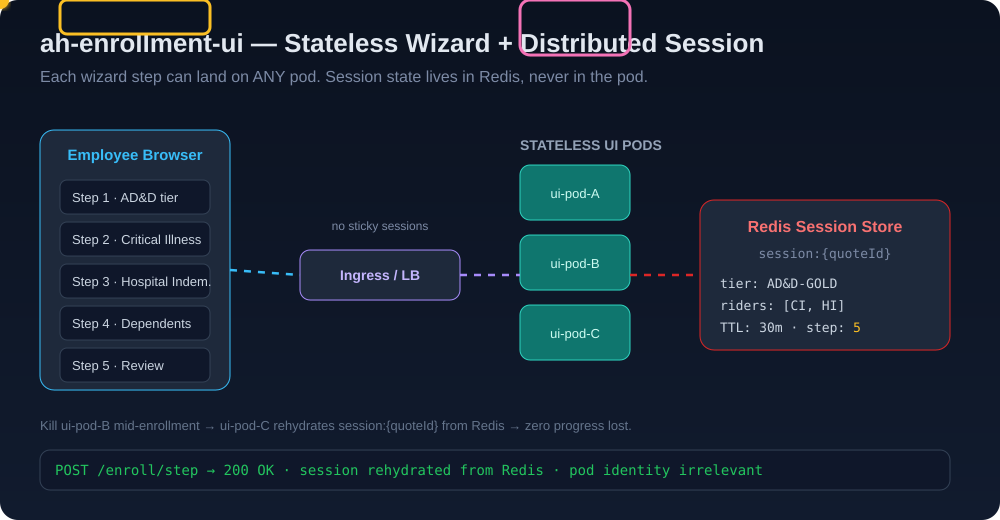
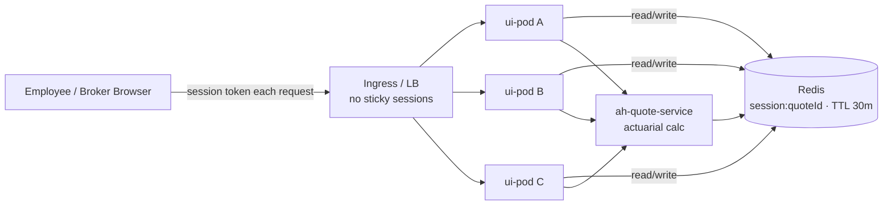
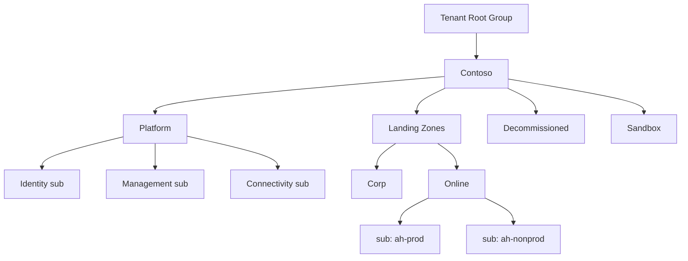
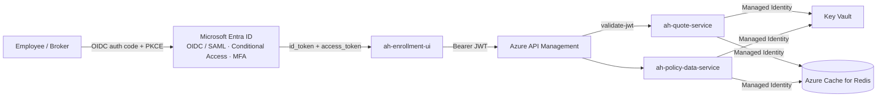

# ah-enrollment-ui

> **Role:** The customer-facing **5-page A&H Quote & Enrollment Wizard**. It is fully
> **stateless** and passes a session token on every request — proving the UI doesn't care
> which backend pod processes the next step of the wizard.

Part of the **A&H Mass Rate-Quote Scalability PoC**:
**`ah-enrollment-ui`** · [`ah-quote-service`](../ah-quote-service) ·
[`ah-policy-data-service`](../ah-policy-data-service) · [`ah-db-migrations`](../ah-db-migrations)

---

## Scaling in action



> The animation shows wizard steps 1→5 landing on **different pods** (A/B/C) through a
> no-sticky-session load balancer, with all progress stored in Redis under `session:{quoteId}`.

---

## Architecture



### The 5-step wizard
`AD&D tier → Critical Illness rider → Hospital Indemnity → Dependents → Review`
Each step is a stateless request; the only durable state is the token + `session:{quoteId}`.

---

## Scaling process (step by step)

1. User starts the wizard; a `quoteId` is minted and stored in Redis.
2. Every "Next" POST carries the session token — the LB routes it to **any** available pod.
3. The handling pod rehydrates `session:{quoteId}` from Redis, applies the step, writes it back.
4. During the spike, the UI deployment scales out like any stateless tier (HPA, 2→N pods).
5. **Resilience demo:** kill a UI pod mid-enrollment → the next pod rehydrates from Redis →
   the user never loses progress.

---

## Azure Enterprise Landing Zone

> This section is the shared platform blueprint referenced by all four repos.

### Management-group hierarchy (Contoso)



**Where to create this project:** under `Contoso → Landing Zones → Online` (internet-facing
workload). Use **two subscriptions** so prod blast-radius and cost are isolated:

| Subscription | Purpose | Example resource groups |
|---|---|---|
| `sub-ah-nonprod` | dev / test / staging | `rg-ah-dev`, `rg-ah-test`, `rg-ah-stg` |
| `sub-ah-prod` | production | `rg-ah-prod-app`, `rg-ah-prod-data`, `rg-ah-prod-network`, `rg-ah-prod-shared` |

> Rule of thumb: **subscription = isolation + quota + billing boundary**;
> **resource group = lifecycle boundary** (things created/deleted together).

### Perfect SSO (Microsoft Entra ID)



- **Human sign-in:** Entra ID with **OIDC (auth code + PKCE)** for the SPA, **Conditional
  Access + MFA**, and **B2B** for external brokers (or **Entra External ID** for consumer-scale).
- **Service-to-service:** **Managed Identities** — no secrets in code. Services pull DB creds
  from **Key Vault** via their identity.
- **API edge:** **Azure API Management** validates the JWT (`validate-jwt`), enforcing scopes
  before any pod is hit.
- **RBAC:** group-based app roles (`Employee`, `Broker`, `Underwriter`, `HR-Admin`).

### Cloud resources to create

| Layer | Azure resource |
|---|---|
| Compute | **AKS** (one cluster per env), separate node pools for UI / quote / data |
| Identity / SSO | **Microsoft Entra ID**, App Registrations, **Managed Identities**, Conditional Access |
| API edge | **Azure API Management**, **Application Gateway + WAF** / Front Door |
| Cache + session | **Azure Cache for Redis** (Premium, clustered) |
| Database | **Azure Database for PostgreSQL – Flexible Server** (primary + read replicas, sharded) |
| Secrets | **Azure Key Vault** |
| Networking | **VNet**, private endpoints, hub-spoke via Connectivity sub |
| Registry | **Azure Container Registry (ACR)** |
| Observability | **Azure Monitor + Log Analytics + Application Insights** |
| CI/CD | **GitHub Actions / Azure DevOps** → ACR → AKS |
| Governance | **Azure Policy**, Management-group-scoped **RBAC**, **Microsoft Defender for Cloud** |

---

## Local run

```bash
npm install
npm run dev   # Vite/React dev server on http://localhost:5173
```
